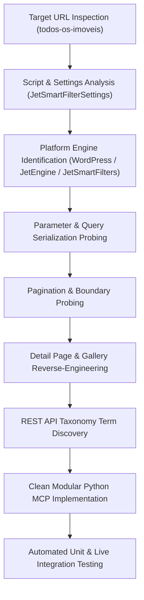

# Rental Search API Reverse-Engineering Research Plan & Report

## 1. Executive Summary

This document presents the reverse-engineering research plan, execution findings, architectural design, and verification results for the real estate portal **Alê Corretora MG** (`alecorretoramg.com.br`).

The research successfully identified all search endpoints, request payload structures, pagination mechanics, filtering conventions, detail page structures, specs extraction patterns, and photo delivery mechanisms necessary to reproduce the rental listing and property retrieval flow.

---

## 2. Research Plan & Methodology

### 2.1 Research Objectives
1. **Endpoint Discovery**: Identify the exact HTTP endpoints responsible for search queries, filtering, pagination, property detail retrieval, and media retrieval.
2. **Parameter Encoding Analysis**: Reverse-engineer parameter conventions, including taxonomy query formats, meta queries, range constraints, and reference code lookups.
3. **Pagination & Boundary Testing**: Determine page size limits, page indicator parameters, and boundary behavior when requesting out-of-bounds pages.
4. **Detail & Media Extraction**: Uncover DOM structures and carousel widgets for property details and high-resolution photo galleries.
5. **Architectural Implementation**: Structure the extracted intelligence into reusable Python modules adhering strictly to SOLID, Clean Code, Object Calisthenics, and Design Patterns.

### 2.2 Investigation Methodology


---

## 3. Reverse-Engineering Findings & Discovery Log

### 3.1 Platform Engine Identification
- **Platform**: WordPress 6.x CMS with Elementor Pro.
- **Engine**: Crocoblock JetEngine (custom post type `imoveis`).
- **Filtering Suite**: Crocoblock JetSmartFilters (`jet-smart-filters`).
- **AJAX Router**: `/wp-admin/admin-ajax.php`.
- **Card Template ID**: Elementor JetEngine listing card template ID `6919` (`jet-listing-grid--6919`).

### 3.2 Target URL Reproduction Analysis
- **Target URL**: `https://alecorretoramg.com.br/todos-os-imoveis/`
- **Search Mechanics**:
  - The static page contains a lazy-loaded listing grid (`jet-listing-grid--lazy-load`).
  - Interactive searches and filter operations trigger an AJAX `POST` to `/wp-admin/admin-ajax.php` with `action=jet_smart_filters`.
  - The server evaluates the query against the `imoveis` custom post type and returns a JSON payload containing the rendered HTML card collection and pagination metadata.
- **Rental Filtering**:
  - Purpose taxonomy: `finalidade`.
  - Rental term ID: `21` ("Alugar").
  - Sales term ID: `20` ("Comprar").

### 3.3 Discovered Parameter Encoding Matrix
During dynamic probing of the search engine, the following parameter semantics were discovered:
1. **Taxonomy Filters (`_tax_query_*`)**:
   - `query[_tax_query_finalidade]`: `21` for rentals, `20` for sales.
   - `query[_tax_query_tipo-de-imovel]`: Property type term ID (`8` Apartamento, `7` Casa, `34` Loja Comercial, `32` Casa Geminada, `56` Chácara, `50` Cobertura, `55` Lote).
   - `query[_tax_query_cidade]`: Municipality term ID (`24` Timóteo, `186` Cel Fabriciano, `25` Ipatinga).
   - `query[_tax_query_bairro]`: Neighborhood term ID (`35` Funcionários, `148` Garapa, `31` Primavera).
2. **Room & Specification Meta Filters (`_meta_query_*`)**:
   - `query[_meta_query_quartos]`: Minimum bedrooms count (`1`, `2`, `3`, `4`).
   - `query[_meta_query_banheiros]`: Minimum bathrooms count (`1`, `2`, `3`, `4`).
3. **Price Range Meta Filter**:
   - `query[_meta_query_preco|range]`: Range formatted as `{min}_{max}` (e.g. `700_1500`, `1500_3500`).
4. **Reference Code Meta Search**:
   - `query[_meta_query_codigo-do-imovel]`: Reference code search (e.g. `0473`).
5. **Pagination**:
   - `paged`: 1-indexed page integer.
   - Fixed page size: **10 listings per page**.
   - End of results: Requesting out-of-bounds page (e.g. `paged=99`) returns `found_posts: 0`, `max_num_pages: 0`, and an empty listing card container.

### 3.4 Discovered Endpoints
| Endpoint | Method | Response Type | Purpose |
| :--- | :--- | :--- | :--- |
| `/wp-admin/admin-ajax.php` | `POST` | JSON (`content`, `pagination`) | Search listings with filters and pagination. |
| `/?p={post_id}` | `GET` | HTTP 301 Redirect | Direct property ID lookup to canonical SEO URL. |
| `/imoveis/{slug}/` | `GET` | HTML (`utf-8`) | Direct property detail page with specs and photo carousel. |
| `/wp-json/wp/v2/cidade` | `GET` | JSON Array | Portal city taxonomy terms. |
| `/wp-json/wp/v2/bairro` | `GET` | JSON Array | Portal neighborhood taxonomy terms. |
| `/wp-json/wp/v2/tipo-de-imovel` | `GET` | JSON Array | Portal property category taxonomy terms. |
| `/wp-json/wp/v2/finalidade` | `GET` | JSON Array | Portal transaction purposes (Alugar/Comprar). |

---

## 4. Software Architecture & Design Principles

The reverse-engineered capabilities have been organized into the `src/alecorretora_research` package, structured to serve as the module boundary for the central rental research MCP.

### 4.1 Prioritization Order
Architectural design adheres strictly to the mandatory priority order:
1. **Correctness First**: Real HTTP requests, complete parameter encoding, resilient parsing of listing cards and detail pages, robust error handling.
2. **Modularity Second**: Decoupled domain models, request payload builder, HTTP abstraction, specialized parsers, and a clean client facade.
3. **Style Principles Third**:
   - **SOLID**: Single Responsibility, Open/Closed, Dependency Inversion.
   - **Object Calisthenics**:
     - Maximum 1 level of indentation per method.
     - Zero `else` keywords (guard clauses and early returns).
     - Primitives wrapped into meaningful domain value objects (`PriceRange`, `RoomCount`, `PageNumber`, `PropertyCode`).
     - First-class collections (`ListingCollection`, `PhotoGallery`, `CityCatalog`, `NeighborhoodCatalog`, `LocationCatalog`).
     - Maximum 2 instance variables per class (composed via collaborator bundles).
     - Functions $\le 15$ lines, classes $\le 100$ lines, modules $< 200$ lines.

### 4.2 Module Structure
```
src/alecorretora_research/
├── __init__.py                # Package exports
├── client.py                  # AleCorretoraRentalClient (central MCP interface)
├── collaborators.py           # RentalNetworkGateway, RentalParserSuite
├── domain/
│   ├── __init__.py
│   ├── criteria.py            # SearchCriteria and parameter bundles
│   ├── enums.py               # TransactionType, PropertyType
│   ├── listing.py             # ListingSummary, ListingCollection (First-class collection)
│   ├── metadata.py            # City, Neighborhood, LocationCatalog (First-class collection)
│   ├── property.py            # PropertyDetail, PhotoGallery (First-class collection)
│   └── values.py              # PriceRange, RoomCount, PageNumber, PropertyCode
├── infrastructure/
│   ├── __init__.py
│   ├── http_client.py         # HttpClientProtocol, HttpxHttpClient, HttpResponse, Exceptions
│   └── payload_builder.py     # RequestPayloadBuilder (JetSmartFilters form data constructor)
└── parsers/
    ├── __init__.py
    ├── detail_parser.py       # PropertyDetailParser (DOM extraction of property detail page)
    ├── feature_extractor.py   # CardFeatureExtractor (card spec and icon extractor)
    ├── metadata_parser.py     # MetadataParser (location & taxonomy parser)
    └── search_parser.py       # SearchResponseParser (parses JSON {content, pagination})
```

---

## 5. Verification & Test Execution Results

The implementation was validated using both unit tests with stubbed HTTP responses and live integration tests against `alecorretoramg.com.br`.

### 5.1 Automated Pytest Results
```
tests/test_client.py::test_client_search_with_stub PASSED                [  4%]
tests/test_client.py::test_client_get_details_with_stub PASSED           [  8%]
tests/test_client.py::test_client_not_found_raises_exception PASSED      [ 12%]
tests/test_domain.py::test_price_range_validations PASSED                [ 16%]
tests/test_domain.py::test_room_count_validations PASSED                 [ 20%]
tests/test_domain.py::test_page_number_validations PASSED                 [ 25%]
tests/test_domain.py::test_property_code_validations PASSED             [ 29%]
tests/test_domain.py::test_search_criteria_rental_factory PASSED         [ 33%]
tests/test_domain.py::test_listing_collection_behavior PASSED            [ 37%]
tests/test_domain.py::test_photo_gallery_behavior PASSED                 [ 41%]
tests/test_domain.py::test_location_catalog_lookups PASSED               [ 45%]
tests/test_live_integration.py::test_live_rental_search PASSED           [ 50%]
tests/test_live_integration.py::test_live_rental_filtered_by_bedrooms PASSED [ 54%]
tests/test_live_integration.py::test_live_rental_filtered_by_price_range PASSED [ 58%]
tests/test_live_integration.py::test_live_rental_filtered_by_code PASSED [ 62%]
tests/test_live_integration.py::test_live_property_detail_retrieval PASSED [ 66%]
tests/test_live_integration.py::test_live_locations_retrieval PASSED     [ 70%]
tests/test_parsers.py::test_search_parser_with_stubbed_json PASSED       [ 75%]
tests/test_parsers.py::test_property_detail_parser PASSED                [ 79%]
tests/test_parsers.py::test_metadata_parser_api_json PASSED              [ 83%]
tests/test_payload_builder.py::test_payload_builder_ajax_endpoint PASSED [ 87%]
tests/test_payload_builder.py::test_payload_builder_detail_url PASSED    [ 91%]
tests/test_payload_builder.py::test_payload_builder_taxonomy_url PASSED  [ 95%]
tests/test_payload_builder.py::test_payload_builder_search_form_data PASSED [100%]

============================== 24 passed in 3.11s ==============================
```

### 5.2 Standalone Verification Execution (`scripts/verify_research.py`)
```
=== Starting Alê Corretora MG Research Verification ===
--- 1. Target URL Rental Search (Alugar / Todos os Imóveis) ---
Total matching rentals found: 4
  [11217] Ref: 0473 | Loja Comercial/Quitinete em Garapa, Timóteo | R$ 700,00 | Garapa, Timóteo
  [10806] Ref: 0462 | Apartamento em Novo Horizonte, Timóteo | R$ 1.600,00 | Novo Horizonte, Timóteo
  [10768] Ref: 0461 | Apartamento em Novo Horizonte, Timóteo | R$ 1.000,00 | Novo Horizonte, Timóteo
  [6658] Ref: 0363 | Casa em Eldorado, Timóteo | R$ 3.200,00 | Eldorado, Timóteo

--- 2. Filtered Rental Search (2 Bedrooms) ---
Total 2-bedroom rentals: 1
  [10806] Ref: 0462 | Apartamento em Novo Horizonte, Timóteo | R$ 1.600,00

--- 3. Filtered Rental Search (Price: R$ 700 to R$ 1.500) ---
Total rentals in price range: 2
  [11217] Ref: 0473 | Loja Comercial/Quitinete em Garapa, Timóteo | R$ 700,00
  [10768] Ref: 0461 | Apartamento em Novo Horizonte, Timóteo | R$ 1.000,00

--- 4. Code Search (Ref: 0473) ---
Total matching properties: 1
  [11217] Ref: 0473 | Loja Comercial/Quitinete em Garapa, Timóteo | R$ 700,00

--- 5. Property Detail Retrieval (ID: 11217 / Ref: 0473) ---
Title: Loja Comercial/Quitinete
Reference Code: 0473
Price: R$ 700,00
Location: Garapa, Timóteo - MG
Specs: 1 dorm, 1 banheiro, Área: Área: 50m²
Photos in Gallery: 9
  Photo 1: https://alecorretoramg.com.br/wp-content/uploads/2026/09/photo_2025-09-04_08-37-47.jpg
  Photo 2: https://alecorretoramg.com.br/wp-content/uploads/2026/09/photo_2025-09-04_08-37-52.jpg
  Photo 3: https://alecorretoramg.com.br/wp-content/uploads/2026/09/photo_2025-09-04_08-36-57.jpg

--- 6. Portal Location Catalog Discovery ---
Total cities indexed: 20
City found: 'Timóteo' (ID: 24)
Total neighborhoods indexed: 100

=== All Verification Steps Completed Successfully ===
```
